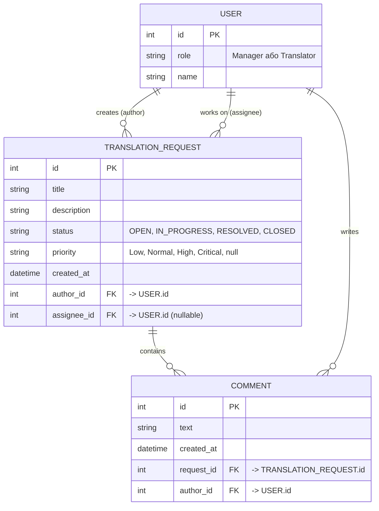
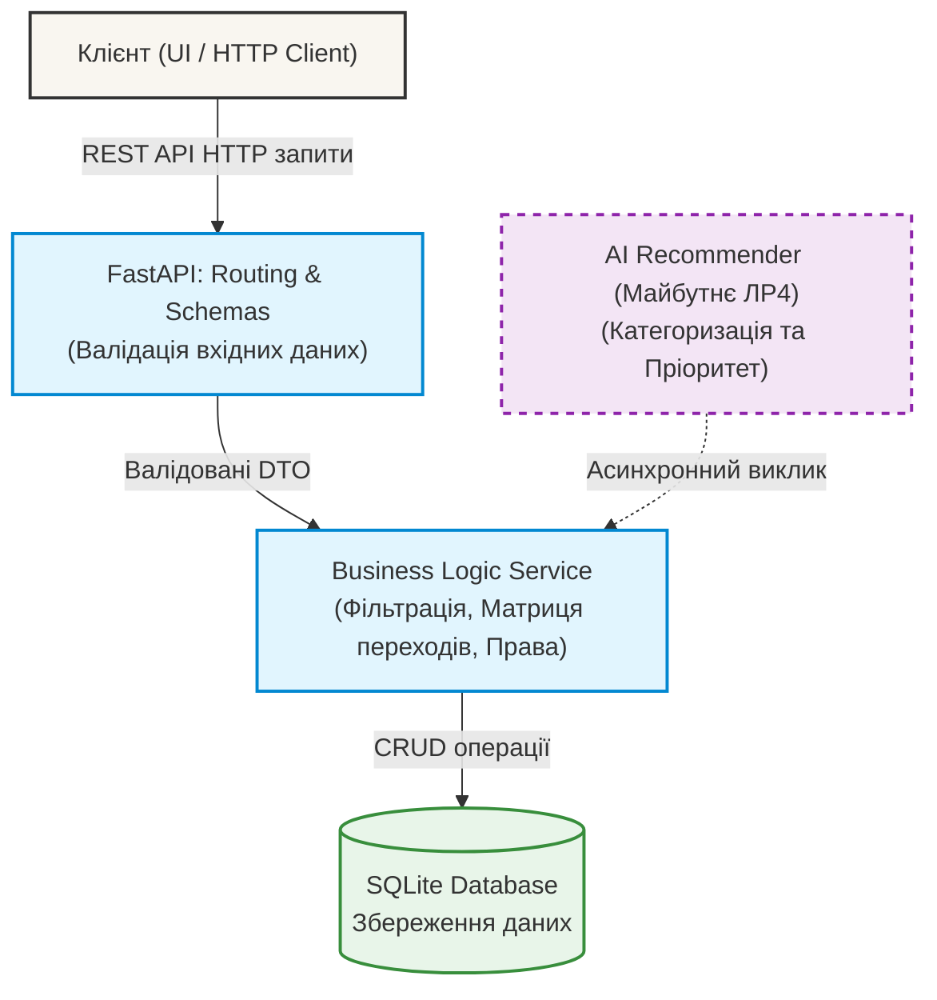

# Архітектура системи VerbaDesk (Architecture Design)

Цей документ описує високорівневу архітектуру внутрішньої системи бюро перекладів VerbaDesk (MVP версія), модель даних та ключові архітектурні рішення (ADR).

## 1. Модель сутностей (Entity-Relationship Model)

Для забезпечення функціональності MVP (FR-01 — FR-07) система використовує 3 основні сутності. Зв'язки між ними організовані так:
* `User` (1) ➔ (Багато) `TranslationRequest` (як автор)
* `User` (1) ➔ (Багато) `TranslationRequest` (як виконавець/assignee)
* `TranslationRequest` (1) ➔ (Багато) `Comment`
* `User` (1) ➔ (Багато) `Comment` (як автор коментаря)

## 2. Схема компонентів (Component Diagram)

Система побудована за трирівневою монолітною архітектурою з чітким розділенням відповідальностей. У майбутньому (ЛР4) до системи буде підключено зовнішній AI-сервіс.

**Розподіл відповідальностей:**
1. **Schemas & Routing (API):** Відповідає за прийом HTTP-запитів, валідацію типів даних, перевірку обов'язковості полів (наприклад, що `title` передано) та повернення HTTP-кодів (200, 201, 404, 422).
2. **Business Logic Service:** Реалізує бізнес-правила (Decision Log), перевіряє права (Manager vs Translator), контролює дозволені переходи статусів (OPEN ➔ IN_PROGRESS) та генерує помилки логіки (403, 409).
3. **Database:** Забезпечує надійне локальне збереження сутностей після перезапуску сервера.

---

## 3. Журнал архітектурних рішень (Architecture Decision Records - ADR)

### ADR-01: Використання SQLite як основної бази даних для MVP
* **Контекст:** Проєкту (VerbaDesk) потрібна надійна база даних для зберігання заявок та коментарів. Система розробляється для невеликого бюро (3 людини), які не створюють великого одночасного навантаження.
* **Варіанти:** SQLite, PostgreSQL, MongoDB.
* **Обране рішення:** Використати **SQLite** із збереженням у локальний файл (`database.db`).
* **Причина:** PostgreSQL вимагає розгортання окремого контейнера або сервера, що суперечить обмеженню "швидко в розробці" та легкому локальному тестуванню. Об'єму та конкурентності SQLite повністю достатньо для MVP з 3 користувачами (NFR-02, NFR-04).
* **Наслідки:** Забезпечується нульова конфігурація для запуску застосунку, легке тестування (ізольована база в пам'яті). Обмеження: SQLite не підходить для горизонтального масштабування, якщо система виросте до сотень користувачів.

### ADR-02: Декаплінг (відокремлення) AI-компонента від бізнес-логіки
* **Контекст:** Згідно з FR-08, у майбутньому система повинна надавати AI-рекомендації щодо категорії тексту та його пріоритету.
* **Варіанти:** 1. Інтегрувати виклик LLM безпосередньо у функцію створення заявки (синхронно). 2. Винести AI-функціонал в окремий сервіс або асинхронну фонову задачу.
* **Обране рішення:** Використати **Варіант 2 (Декаплінг)**. AI працює як ізольований радник.
* **Причина:** Синхронний виклик LLM під час створення заявки порушить NFR-01 (Час відповіді < 1 с). Крім того, згідно з правилом BR-12, ШІ носить лише рекомендаційний характер і не має права автоматично змінювати дані в базі.
* **Наслідки:** Система буде функціонувати швидко і безвідмовно навіть тоді, коли зовнішнє API штучного інтелекту буде недоступним. Користувач не відчує затримок під час збереження заявки.